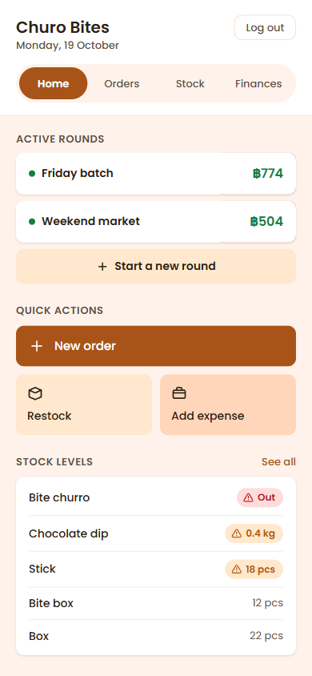
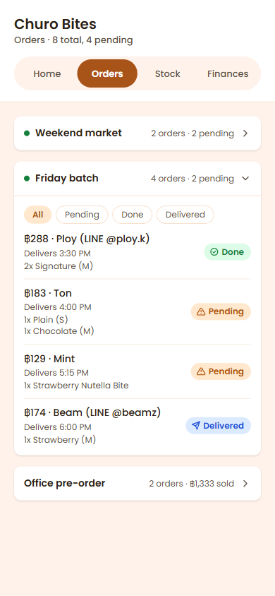
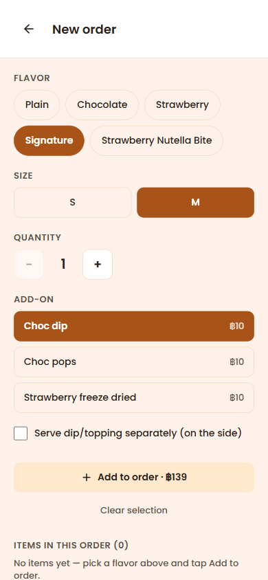
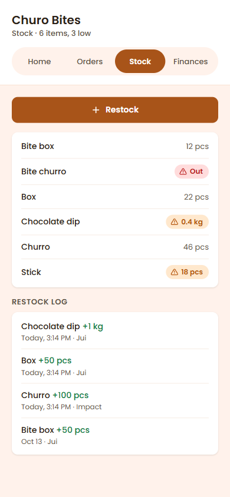
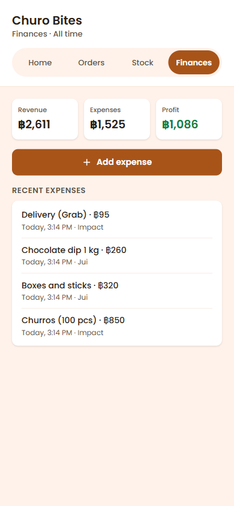

# Churo Bites Operations Dashboard

เว็บแอปบนมือถือสำหรับจัดการออเดอร์ สต็อก และรายรับรายจ่ายของ **Churo Bites** ร้านชูโรส์เล็ก ๆ ที่ผมเปิดกับเพื่อน ปกติเรารับออเดอร์ทาง LINE และต้องจดเองหลายที่ แอปนี้รวมทุกอย่างไว้ที่เดียว ให้สองคนใช้พร้อมกันได้จากมือถือของแต่ละคน

ใช้งานจริงแล้วตั้งแต่ตุลาคม 2026 (frontend บน Vercel, backend บน Railway, ฐานข้อมูล MongoDB Atlas) แอปนี้ใช้ภายในร้าน จึงไม่มีหน้าสมัครสมาชิกและไม่มี demo สาธารณะ แต่รันในเครื่องตัวเองได้ตามขั้นตอนด้านล่าง

<p>
  
  
  
  
  
</p>

<sub>ภาพจากเครื่อง dev ที่ขนาดจอ 390px ใช้ข้อมูลตัวอย่าง ไม่ใช่ลูกค้าจริง</sub>

## ทำอะไรได้บ้าง

- **รอบการขาย (Round):** เปิดได้หลายรอบพร้อมกัน แต่ละรอบมีวันเปิดและวันส่ง หน้า Home แสดงยอดขายของแต่ละรอบ ปัดซ้ายเพื่อปิดรอบ
- **ออเดอร์:**
  - ฟอร์มเดียวจบ: เลือกรสชาติ ไซซ์ จำนวน add-on และค่าส่ง ราคารวมคำนวณให้ทันที
  - ดูออเดอร์แยกตามรอบ กรองได้ตามสถานะ Pending / Done / Delivered
  - แก้ออเดอร์ได้ และยกเลิกได้ (ต้องกดสองครั้ง)
- **สต็อกตัดอัตโนมัติ:** ทุกออเดอร์ตัดชูโรส์ ไม้ และกล่องตามกฎที่ตั้งไว้ในแต่ละรายการ
  - ยกเลิกหรือแก้ออเดอร์ สต็อกคืนตามจริง
  - ป้าย **Low** / **Out** เตือนเมื่อของใกล้หมด
- **เติมสต็อก:** พิมพ์ชื่อของได้อิสระ ถ้าชื่อยังไม่มีจะเริ่มติดตามรายการใหม่ ทุกครั้งที่เติมมีบันทึกไว้ดูย้อนหลัง
- **การเงิน:** บันทึกรายจ่าย และสรุปรายรับ รายจ่าย กำไรรวมทั้งหมด
- **ใช้สองเครื่องพร้อมกัน:** ข้อมูลที่อีกเครื่องแก้จะขึ้นภายใน 7 วินาที

## Tech stack

| ส่วน | ใช้อะไร |
|---|---|
| Frontend | React 19, Vite, Tailwind CSS v4, React Router, TanStack Query v5 (React Compiler เปิดอยู่) |
| Backend | Node.js 24, Express 5, Mongoose 9 |
| Database | MongoDB Atlas |
| Auth | JWT + bcrypt |
| Deploy | Vercel (frontend), Railway (backend) |

## การตัดสินใจที่น่าสนใจ

**โครงสร้างข้อมูลและการใช้งานพร้อมกัน**
- **ทำไมต้องมี backend:** สองคนรับออเดอร์พร้อมกันคนละเครื่อง และต้องเห็นสต็อกตัวเดียวกัน แอปที่เก็บข้อมูลไว้ในเครื่องอย่างเดียวจึงใช้ไม่ได้
- **ทำไมใช้ polling ทุก 7 วินาที ไม่ใช่ WebSocket:** สำหรับ 2 คน ช้าไม่เกิน 7 วินาทียังรับได้ และโค้ดง่ายกว่ามาก
  - TanStack Query ช่วยทั้ง polling และ cache สลับแท็บแล้วข้อมูลขึ้นทันที (ประมาณ 10–20 ms แทนที่จะขึ้น "Loading…" 180–575 ms)
- **ตัวเลขเปลี่ยนด้วย `$inc` แบบ atomic:** สต็อกไม่ได้อ่านค่ามาแล้วเขียนกลับ ถ้าสองเครื่องตัดสต็อกพร้อมกัน ตัวเลขจะไม่ทับกัน
- **บันทึกก่อนเปลี่ยนตัวเลข:** เขียนออเดอร์หรือบันทึกการเติมสต็อกลงฐานข้อมูลก่อน แล้วค่อยปรับสต็อก ถ้าพังกลางทางจะเหลือบันทึกที่ตรวจสอบย้อนหลังได้ ไม่ใช่ตัวเลขที่เปลี่ยนไปโดยไม่มีที่มา
- **ออเดอร์จำว่าตัดสต็อกไปเท่าไหร่:** ยกเลิกหรือแก้ออเดอร์จะคืนตามจำนวนนั้น ถึงกฎการตัดสต็อกจะเปลี่ยนไปภายหลังก็ยังคืนถูก
- **ลบแบบ soft delete:** รายการสต็อกที่ลบและออเดอร์ที่ยกเลิกยังอยู่ในฐานข้อมูล ประวัติการเติมสต็อกจึงไม่ขาดหาย

**ความปลอดภัย (ทำก่อน deploy)**
- **ไม่มีหน้าสมัครสมาชิก:** สร้าง account ได้ด้วย script เท่านั้น ถ้าเปิดให้สมัครเอง ใครก็เข้ามาดูออเดอร์และตัวเลขเงินของร้านได้
- **Log out ใช้ได้จริง:** token มี `tokenVersion` กด Log out แล้ว token ของ account นั้นใช้ไม่ได้ทุกเครื่อง
- **จำกัดการ login:** ผิดได้ 10 ครั้งต่อ 15 นาทีต่อ IP
  - บน Railway นับตาม header `X-Real-IP` เพราะจำนวน proxy ที่อยู่หน้าแอปไม่คงที่ ถ้าใช้ `req.ip` ทุกคนอาจถูกนับรวมเป็นคนเดียว
- **ป้องกันอื่น ๆ:**
  - CORS รับเฉพาะที่อยู่ของแอปเอง
  - `helmet`
  - ป้องกัน NoSQL injection ในหน้า login
  - error ที่ส่งกลับไม่เปิดเผยรายละเอียดภายในของ server
- **Backup:** Atlas แพ็กเกจฟรีไม่มี backup ให้ จึงเขียน script backup และ restore เอง แล้วซ้อมกู้คืนจริงแล้ว 1 ครั้ง

## โครงสร้างโปรเจกต์

```
client/            React app (Vite)
  pages/           หน้าทั้งหมด (Home, Orders, NewOrder, Stock, Finances, …)
  src/
    api.js         fetch + จัดการ token / 401
    queries.js     key และ preset ของ TanStack Query ทั้งหมด
    components/    คอมโพเนนต์ที่ใช้ร่วมกัน
    constants/     ราคา รสชาติ สถานะ
server/            Express API
  models/          User, Round, Order, StockItem, RestockLog, Expense
  controllers/     ตรรกะของแต่ละ resource
  routes/          /api/v1/...
  utils/           catchAsync, AppError, stockDeduction (คำนวณการตัดสต็อก)
  scripts/         seed account / stock, backup / restore
docs/screenshots/  ภาพใน README
```

## รันในเครื่อง

ต้องมี Node.js 24 และ MongoDB (ใช้ Atlas แพ็กเกจฟรีได้)

```bash
# 1. backend
cd server
npm install
cp config.env.example config.env   # แล้วใส่ DATABASE, DATABASE_PASSWORD, JWT_SECRET
node scripts/seedStock.js          # รายการสต็อกตั้งต้นและกฎตัดสต็อก
node scripts/seedAccount.js Jui you@example.com   # ถามรหัสผ่าน (12 ตัวขึ้นไป) แบบซ่อนตัวอักษร
npm run dev                        # http://localhost:3000

# 2. frontend (เปิดอีกเทอร์มินัล)
cd client
npm install
npm run dev                        # http://localhost:5173
```

- **ชื่อ account ต้องเป็น `Jui` หรือ `Impact`:** เพราะเป็นชื่อพนักงานที่ server บันทึกในทุกออเดอร์ (`server/constants/staffMembers.js`) ถ้าจะใช้ชื่ออื่นให้แก้ไฟล์นั้น
- **frontend เรียก `http://localhost:3000` โดยค่าเริ่มต้น:** ตั้ง `VITE_API_URL` เพื่อชี้ไปที่อื่น
- **script ที่เขียนลงฐานข้อมูลจะถามยืนยันก่อนทุกครั้ง:** บอกว่ากำลังจะเขียนลงฐานข้อมูลไหน และใช้ `ENV_FILE=config.prod.env` เพื่อรันกับ production

## วิธีพัฒนา

โปรเจกต์นี้พัฒนาร่วมกับ [Claude Code](https://claude.com/claude-code) ผมเป็นคนตัดสินใจเรื่อง UX, flow และสถาปัตยกรรมเองทั้งหมด และทดสอบทุกฟีเจอร์ก่อน merge ส่วน Claude ช่วยเขียนโค้ด อธิบายเหตุผล และตรวจความปลอดภัย [CLAUDE.md](CLAUDE.md) คือบันทึกการตัดสินใจและบริบทที่ใช้ทำงานร่วมกัน ส่วน [todo.TODO](todo.TODO) คือ log ของแต่ละงาน พร้อมเหตุผลและผลทดสอบ

## สิ่งที่อยากทำต่อ

- automated tests
- Socket.io ให้ข้อมูลอัปเดตทันทีแทน polling
- TypeScript
